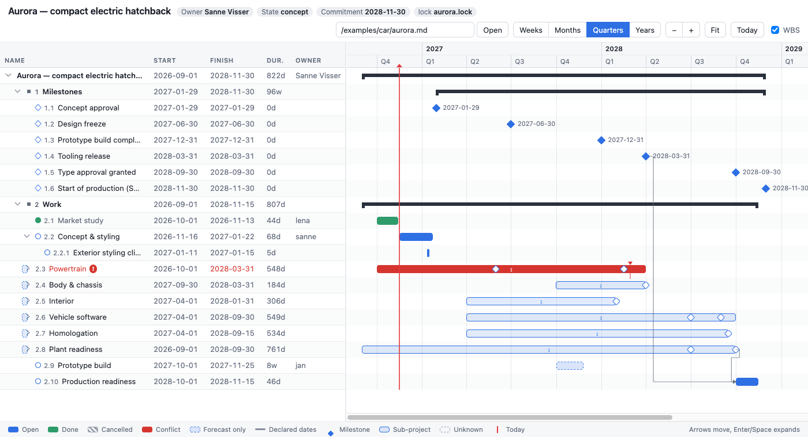

# projectmd

**A plain-markdown format for project plans, and a model for scaling them: from one todo list
to a large programme spread across many teams, repositories and companies.**

Many interdependent projects must come together on strict timelines, with milestones,
decision gates and sign-offs. Ticket trackers are poor at timelines, scheduling tools are heavy
and siloed, and text todo lists show *what* but not *when*. projectmd keeps the todo list and
adds just enough structure to answer "when?" and "what depends on what?":

```markdown
# Battery pack — 60 kWh platform pack

- Owner: Priya Nair <priya.nair@example.com>
- Commitment: 2027-11-30

## Work
- [x] 2026-10-31 Cell chemistry selected  ^chemistry
- [ ] Module & pack design  12w  after: ^chemistry  owner: @priya
- [ ] 2027-09-30 B-samples available  ^b-samples
- [ ] [Cell module](cell-module.md)  by: 2027-06-30
```

- **Every file is a project.** Its list items are tasks and milestones. A link to another file
  makes that file a sub-project, wherever it lives.
- **Time is built in at every level.** You can use dates, rough dates (`2027-Q3`), durations
  (`12w`) and dependencies (`after:`). A parent states what it needs (`by:`) and a child states
  what it promises (`Commitment:`).
- **It scales by locality.** Only declared dates cross file boundaries. Any view reads one file
  plus its lock file, whether the graph has 10 projects or 100,000.

## Grow it gradually, top-down or bottom-up

A plan does not have to start big. Each step below is optional, and each keeps the files you
already have valid:

1. **A todo list.** `- [ ] Order cells` is already a project.
2. **Add time** where it helps: a date, a duration, an `after:`. Tools now forecast and flag
   conflicts.
3. **Split** a task that grew into its own file and link it. That file is now a sub-project.
4. **Promise and expose.** Give the file a `Commitment:`. Its milestones are visible to whoever
   links it (`#private` hides one); tasks and sub-projects stay private unless tagged `#public`.
   That is its interface.
5. **Distribute.** Sub-projects can live anywhere a link can point: another folder, repository,
   server or a supplier's portal. Each is kept by its own team, with its own tools.

You can grow **top-down**, where a programme lead writes a skeleton and links placeholder files
that teams fill in, or **bottom-up**, where existing team plans are linked into a new parent.
Both meet in the same graph. No file is special: every project is the top of its own view, and
any sub-project can be moved elsewhere and stand on its own.

**Contracts cross boundaries, nothing else.** Between a parent and a child the contract is the
parent's need-by date (`by:`) and the child's promise (`Commitment:` and milestones). A
tool-written lock file next to each project (`aurora.md` → `aurora.lock`) records the contracts
with its direct links and whether each child is running late. Like export data in a Go build,
that already summarizes everything further down. A slip deep in the graph surfaces one level up
at a time, and reading or refreshing a plan never looks further than its direct links, however
large and spread out the graph is. See [docs/FORMAT.md](docs/FORMAT.md) §9.

## Tools

The format is the product. The tools in this repository are a first reference implementation:
a parser and validator (Rust, also compiled to WebAssembly) and a web viewer that draws a
project graph as an expandable Gantt chart. Anyone can write others: the files are plain
markdown and the grammar is specified.



> Status: **early draft.** The format may still change.

## Documentation

| Document | For |
|---|---|
| [docs/CHEATSHEET.md](docs/CHEATSHEET.md) | The whole format on one page. Start here, or hand it to an AI agent. |
| [docs/FORMAT.md](docs/FORMAT.md) | Format reference: the node model, scheduling, interfaces, the lock file, validation. |
| [docs/GRAMMAR.md](docs/GRAMMAR.md) | The precise grammar. It decides how text is parsed. |
| [docs/VIEWER-CONTRACT.md](docs/VIEWER-CONTRACT.md) | How the reference viewer calls the parser (WebAssembly interface). |
| [docs/BENCHMARKS.md](docs/BENCHMARKS.md) | Parser scaling measurements. |
| [examples/](examples/README.md) | A worked example: the plan for a fictional electric car, 20 files up to 5 levels deep. |

## Quick start

**Viewer.** Serve the repository root, then open a project:

```bash
python3 -m http.server 8642
```

Open http://localhost:8642/viewer/?root=/examples/car/aurora.md. Click the chevron to expand a sub-project
(it loads lazily), select any row to see everything known about it, and open its file in the
built-in markdown view. Ctrl/Cmd-click or double-click a sub-project to make it the top level.

**Command-line tool** (needs Rust):

```bash
cd parser && cargo build --release
./target/release/pmd check ../examples/car/aurora.md      # validate one level, with fix hints (--deep, --json)
./target/release/pmd schedule ../examples/car/aurora.md   # forecast dates and conflicts
./target/release/pmd tree ../examples/car/aurora.md       # top-level outline
./target/release/pmd lock ../examples/car/aurora.md       # refresh aurora.lock
./target/release/pmd fmt ../examples/car/aurora.md        # canonical form (--ids adds ^ids)
```

Rebuild the viewer's WebAssembly module with `parser/build-wasm.sh`.

## Repository layout

```
docs/        user documentation (format, grammar, viewer contract, benchmarks)
examples/    worked example project graph
parser/      Rust workspace: pmd-core (library), pmd-cli (`pmd`), pmd-wasm (browser build)
viewer/      static web Gantt viewer (HTML/CSS/JS + pmd.wasm), no build step
testdata/    language-neutral conformance cases for parsers
cmd/pmdgen/  synthetic project-graph generator for benchmarks (Go)
```

## License

Licensed under either of

- Apache License, Version 2.0 ([LICENSE-APACHE](LICENSE-APACHE) or http://www.apache.org/licenses/LICENSE-2.0)
- MIT license ([LICENSE-MIT](LICENSE-MIT) or http://opensource.org/licenses/MIT)

at your option.

Unless you explicitly state otherwise, any contribution intentionally submitted for inclusion in
the work by you, as defined in the Apache-2.0 license, shall be dual licensed as above, without
any additional terms or conditions.
