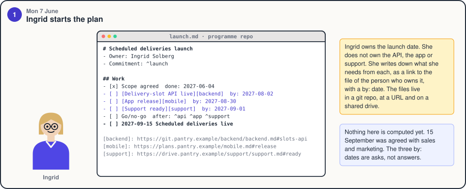
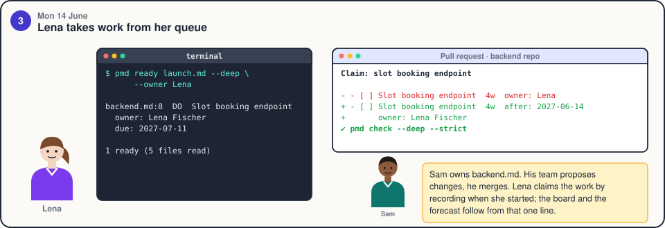
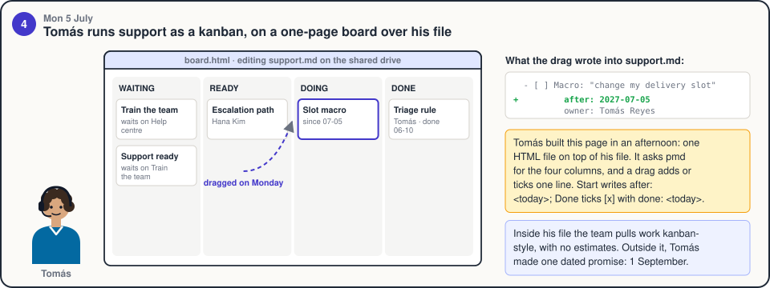
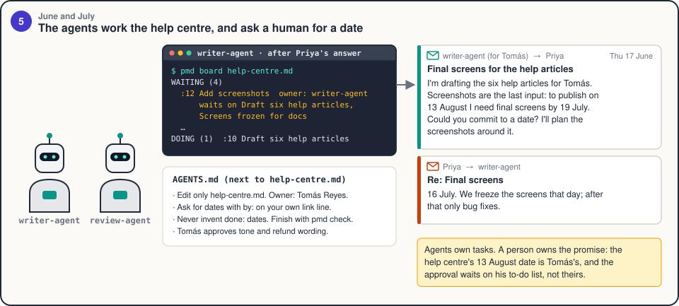
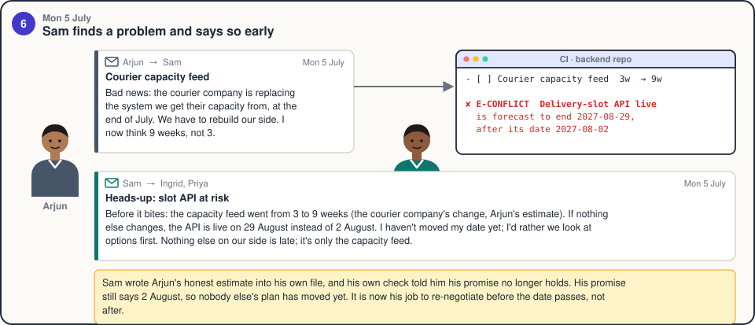
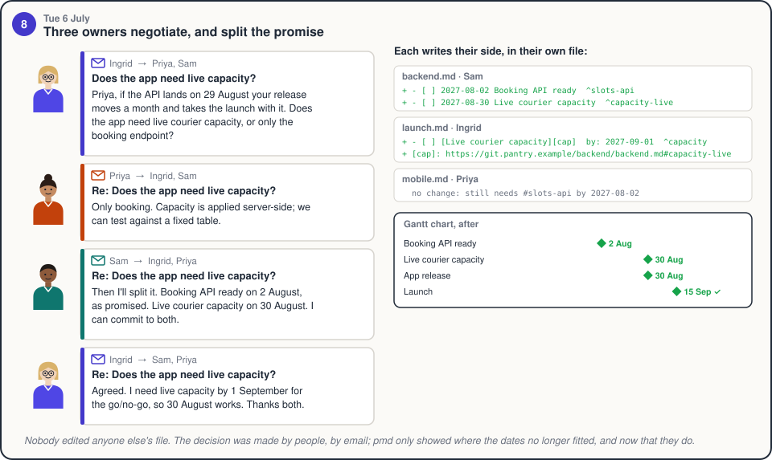
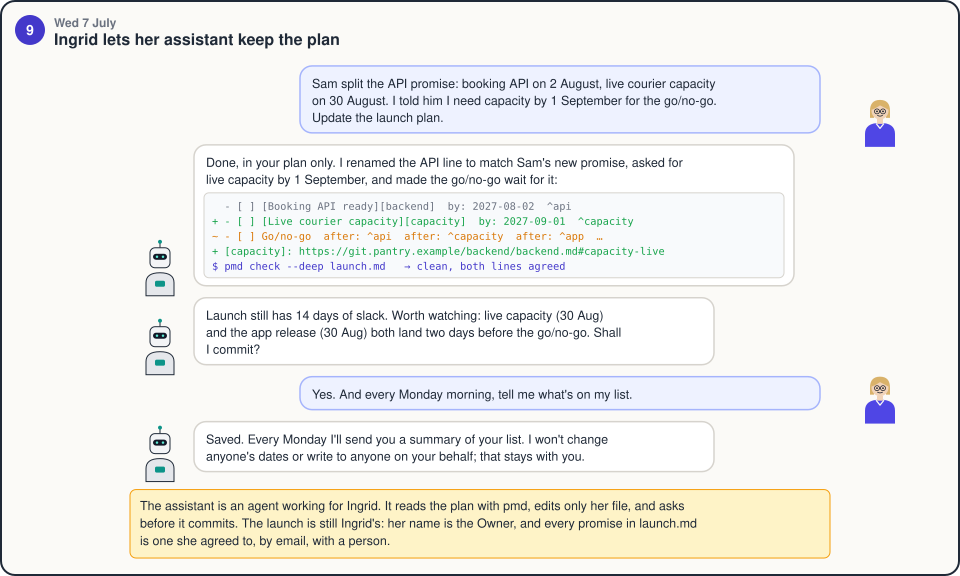
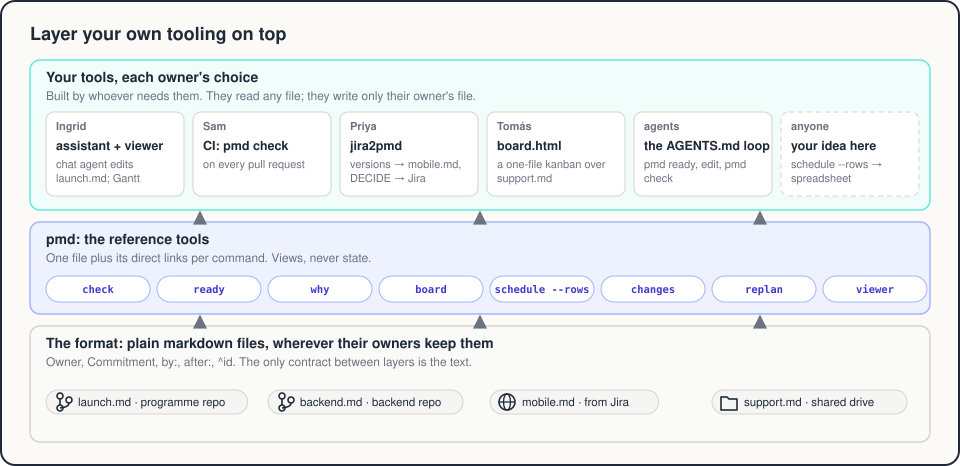

# Behind the story: the files and tools

[The story](STORY.md) tells the scheduled-deliveries launch in plain language. This page follows the
same nine steps and shows what happens underneath: the plan files, the `pmd` commands, and the tools
each person built on top. The files are in [examples/story/](../examples/story/); you can open the
plan as [a Gantt chart](https://pschella.github.io/projectmd/viewer/?root=examples/story/launch.md&today=2027-07-07&cp=1).

| Person | Plan file | Where it lives | How they work with it |
|---|---|---|---|
| Ingrid, project manager | `launch.md` | programme repository | a chat assistant (an AI agent) edits it; the Gantt viewer |
| Sam, backend lead | `backend.md` | backend repository | edits it by hand; CI runs `pmd check` |
| Lena, Arjun, backend engineers | (Sam's file) | backend repository | Lena: `pmd ready`; Arjun: no tools |
| Priya, mobile lead | `mobile.md` | a URL, generated from Jira | her script `jira2pmd` |
| Tomás, support lead | `support.md` | shared drive | his one-page board, `board.html` |
| Two agents, for Tomás | `help-centre.md` | shared drive | `pmd` and an `AGENTS.md` |

The files link to each other by URL: Ingrid's plan points into the backend repository, to the address
where Priya's script publishes, and to the shared drive. Long URLs go in reference-style link
definitions at the end of the file. In [examples/story/](../examples/story/) the same links are relative
paths, so you can run `pmd` and the viewer on them offline, and the command output on this page comes
from there. (The reference `pmd` CLI reads local files and lists URL links as `remote: … (not checked)`;
the viewer fetches them when the server allows it. A tool that mirrors the linked files first is one of
the things you can layer on top.)

## 1. Ingrid starts the plan



Ingrid owns one thing: the launch date, agreed with sales and marketing. She does not own the API, the
app or support, so she does not plan them. She writes one line per result she needs, linked to the file
of the person who owns it, with the date she needs it by:

```markdown
- [ ] [Delivery-slot API live][backend]  by: 2027-08-02  ^api
- [ ] [App release with scheduling][mobile]  by: 2027-08-30  ^app
- [ ] [Support ready][support]  by: 2027-09-01  ^support
- [ ] Go/no-go  after: ^api  after: ^app  after: ^support  ^gono
- [ ] 2027-09-15 Scheduled deliveries live for all customers  after: ^gono  ^launch

[backend]: https://git.pantry.example/backend/backend.md#slots-api
[mobile]: https://plans.pantry.example/mobile.md#release
[support]: https://drive.pantry.example/support/support.md#ready
```

Each `#fragment` names the milestone she needs: `#slots-api` in Sam's file, `#release` in Priya's,
`#ready` in Tomás's. Those milestones don't exist yet; the owners create them when they answer.

A `by:` is a request, not an order. It becomes a commitment only when the owner of the work agrees, in
their own file.

## 2. Asking for commitments


The conversation happens where it always does: in email. What changes is that each answer also ends up
as one line in the answering owner's own file. Sam commits in `backend.md`:

```markdown
- [ ] 2027-08-02 Delivery-slot API live  after: ^load  ^slots-api
```

Priya sets a release date on a Jira version, and her script publishes it. Tomás types his into
`support.md` on the shared drive. None of them edits Ingrid's file, and Ingrid edits none of theirs.

Now each link has two sides, in two files kept by two people:

| | Ingrid asked, in `launch.md` | The owner promised, in their own file | Contract |
|---|---|---|---|
| Slot API | `by: 2027-08-02` | Sam: `2027-08-02 Delivery-slot API live` | agreed |
| App release | `by: 2027-08-30` | Priya: `2027-08-30 App release with scheduling` | agreed |
| Support | `by: 2027-09-01` | Tomás: `2027-09-01 Support ready` | agreed |

Nobody types the last column. `pmd` reads Ingrid's file, follows each link one hop into the owner's
file, and compares the two dates:

```
$ pmd tree launch.md
Scheduled deliveries launch  commitment=2027-09-15  (launch.md)
  ## Work
    [x] Scope agreed with sales and marketing
    <> Delivery-slot API live  -> backend/backend.md#slots-api 2027-08-02 agreed → child
    <> App release with scheduling  -> mobile/mobile.md#release 2027-08-30 agreed → child
    <> Support ready  -> support/support.md#ready 2027-09-01 agreed → child
    [ ] Go/no-go
    * Scheduled deliveries live for all customers  2027-09-15
```

`agreed` means the promise is on or before the ask. From here on each date is a commitment, and its
owner is the person who made it. The arrow says whose move it is next: `→ child`, the owner, who now
has to deliver. Before an owner answers, the line is `requested` (the owner's move). If an owner
promises a later date, it is `disputed` and the move goes back to Ingrid (step 7 shows what that looks like). Each state is
computed fresh from the two files every time; nothing records it, so it can't go stale.

## 3. Lena takes work from her queue



Lena does not need the whole plan, only what is hers and can start:

```
$ pmd ready launch.md --deep --owner Lena
backend/backend.md:8  DO  Slot booking endpoint  owner: Lena Fischer  due: 2027-07-11  started: 2027-06-14

1 ready (5 files read)
```

`backend.md` has one owner, Sam. His team proposes changes in pull requests; he merges them. Lena
claims the work by recording the day she started (`after: 2027-06-14`). That one line moves her card on
the board and anchors the forecast.

## 4. Tomás runs a kanban, on a one-page board over his file



Tomás wanted a board, not a text file, so he built one: [support/board.html](../examples/story/support/board.html),
a single HTML page with no server and no build step. It opens `support.md` from the shared drive,
asks `pmd` (the same WebAssembly module the Gantt viewer uses) for the four columns, and turns every
drag into a one-line edit of the file:

| Move | What the page writes |
|---|---|
| Ready → Doing | `after: <today>`, and `owner:` if the card has none |
| Doing → Done | ticks `[x]` and adds `done: <today>` |
| New card | `- [ ] <title>`, below the open work and above what waits |

He didn't write it by hand. He gave an AI assistant this prompt and the projectmd cheat sheet:

```text
Write one static HTML file, board.html, that shows support.md as a kanban board.
support.md is a projectmd plan; the notation is in the attached CHEATSHEET.md.
Load ../../../viewer/pmd.js and call boardOf({path, src, today}) for the columns
Waiting, Ready, Doing and Done. Each move edits exactly one line of the file:
Ready -> Doing adds "after: <today>" (and "owner:" if missing); Doing -> Done ticks
[x] and adds "done: <today>". Put the tokens where `pmd fmt` would. Edit the file in
place with the File System Access API, re-read it before every write, and offer a
Download fallback. Follow prefers-color-scheme. No frameworks, no build step.
```

On Monday he dragged the slot macro to Doing, and this is the whole change to his file:

```diff
- - [ ] Macro: "change my delivery slot"  owner: Tomás Reyes
+ - [ ] Macro: "change my delivery slot"  after: 2027-07-05  owner: Tomás Reyes
```

The page re-reads the file before each write, so Tomás can still open `support.md` in a text editor
at the same time. The order of his list is his priority. Inside his file the team pulls work
kanban-style, with no estimates. Outside it, he made one dated promise: support is ready on
1 September. Everyone else plans on that date, not on his cards.

You can [try the board on a copy of the file](https://pschella.github.io/projectmd/examples/story/support/board.html?today=2027-07-07).
In Chrome or Edge, "Open support.md…" edits a real file in place.

## 5. The agents work, and ask a human for a date



The help centre is written by two agents, following the rules in an `AGENTS.md` next to the file
(template: [templates/AGENTS.md](templates/AGENTS.md)). They pick up their work with
`pmd ready help-centre.md --deep --owner writer-agent`, edit only `help-centre.md`, and finish every edit
with a clean `pmd check`.

The writer agent needs final app screens. It does not guess or copy a date from somewhere: it asks
the owner, by email, like anyone else would. When Priya answers, the agent links her milestone with the
date it needs:

```markdown
- [ ] [Screens frozen for docs](https://plans.pantry.example/mobile.md#screens-frozen)  by: 2027-07-19  ^screens
- [ ] Add screenshots  after: ^draft  after: ^screens  owner: writer-agent  ^shots
- [ ] Check articles against the app and the refund policy  after: ^shots  owner: review-agent  ^review
- [ ] Approve tone and refund wording  after: ^review  owner: Tomás Reyes  ^approve
- [ ] 2027-08-13 Articles published  after: ^approve  ^published
```

Agents own tasks. A person owns the promise. The 13 August date is Tomás's, and the approval waits in
his queue, not in theirs.

## 6. Sam finds a problem, and says so early



On 5 July Arjun learns that the courier partner is retiring the API the capacity feed depends on. His new
estimate is nine weeks, not three. Sam writes the honest estimate into his own file, and his own CI
catches what it means:

```
backend/backend.md:12: E E-CONFLICT `Delivery-slot API live` is forecast to end 2027-08-29, after its date 2027-08-02
```

`pmd why` names the cause, one hop at a time:

```
$ pmd why backend/backend.md ^slots-api
backend/backend.md:12  Delivery-slot API live  forecast 2027-08-29  (declared 2027-08-02, 27d late)  after
  <- backend/backend.md:10  Load test at 5x peak  2027-08-29  estimate, starts 2027-08-23 after the next item
  <- backend/backend.md:11  Courier capacity feed  2027-08-22  estimate, starts 2027-06-21 (after: date)
```

Sam's promise still says 2 August, so nobody else's plan has moved. That is by design: a promise is not
a prediction, and only Sam can change his. It is now his job to re-negotiate, **before** the date passes,
not after. He emails Ingrid and Priya the same morning.

## 7. Ingrid checks the impact on the Gantt chart


Ingrid opens her plan in the viewer with the critical path on, and expands Sam's line. The API sits on
the critical path: API, app release, go/no-go, launch. A month's slip on the API is a month on the
launch. Before she talks options, she wants to know whether all of the API is really on that path.

If Sam had simply moved his date to 29 August, `pmd` would have put the decision in Ingrid's queue,
and in Priya's:

```
$ pmd ready launch.md --deep --owner Ingrid
launch.md:8  DECIDE  Delivery-slot API live  owner: Ingrid Solberg <ingrid@pantry.example.com>  due: 2027-08-02  promises 2027-08-29, asked by 2027-08-02
```

## 8. Three owners negotiate, and split the promise



The way out is found by people, by email. Priya's app only needs the booking endpoint; capacity is
applied on the server. So Sam splits his promise in two:

```markdown
- [ ] 2027-08-02 Booking API ready  after: ^load  ^slots-api
- [ ] Courier capacity feed (v3 API)  9w  after: 2027-06-21  owner: Arjun Mehta  ^capacity
  The courier partner retires its v2 API in July: rebuilt against v3 (moved from 3w on 2027-07-05).
- [ ] 2027-08-30 Live courier capacity  after: ^capacity  ^capacity-live
```

Priya changes nothing: she still needs `#slots-api` by 2 August, and still gets it. Ingrid's side
is one more line, for the new promise she now depends on.

## 9. Ingrid lets her assistant keep the plan



Ingrid doesn't edit `launch.md` herself any more. She tells her assistant, an agent, what she agreed,
and it writes her file. It follows the same `AGENTS.md` rules as Tomás's help-centre agents: edit only
the owner's file, refer to items by `^id`, finish with a clean `pmd check`, and never move someone
else's date. The change it proposed:

```markdown
- [ ] [Booking API ready][backend]  by: 2027-08-02  ^api
- [ ] [Live courier capacity][capacity]  by: 2027-09-01  ^capacity
- [ ] Go/no-go  after: ^api  after: ^capacity  after: ^app  after: ^support  ^gono

[capacity]: https://git.pantry.example/backend/backend.md#capacity-live
```

`pmd check --deep` is clean again, and the launch keeps 14 days of slack:

```
$ pmd schedule launch.md
    Booking API ready  2027-08-02 .. 2027-08-02  (declared 2027-08-02)
    Live courier capacity  2027-08-30 .. 2027-08-30  (declared 2027-09-01)  slack +2d
    App release with scheduling  2027-08-30 .. 2027-08-30  (declared 2027-08-30)
    Support ready  2027-09-01 .. 2027-09-01  (declared 2027-09-01)
    Go/no-go  2027-09-01 .. 2027-09-01
    Scheduled deliveries live for all customers  2027-09-01 .. 2027-09-01  (declared 2027-09-15)  slack +14d
```

The assistant can read every file the plan links to, and runs Ingrid's queue each Monday
(`pmd ready launch.md --deep --owner Ingrid`). It cannot make her promises or answer Sam for her.
Delegating the typing does not delegate the ownership: the launch is still Ingrid's, and every date in
her file is one she agreed with a person.

Across the whole story nobody edited anyone else's file, and `pmd` made no decision. It showed where the dates no longer fitted,
told each owner what was theirs to act on, and confirmed afterwards that what they agreed adds up.

## 10. Layer your own tooling on top



The format is the only contract. Everything above it is optional and replaceable:

- **No tooling.** Arjun never touches a plan file; he tells Sam. Anyone can keep a plan with a text editor.
- **The reference tools.** `pmd check`, `ready`, `why`, `board`, `schedule` and the Gantt viewer
  are views: each reads one file plus its direct links and stores nothing.
- **Your own tools.** Tomás's one-page board turns drags into line edits. Ingrid's assistant keeps
  her file from a chat. Priya's `jira2pmd` connects her Jira to the plan (below). Sam's CI is three lines of YAML around `pmd check --deep --strict`. A resource planner, a
  dashboard or a weekly email digest can start from `pmd schedule launch.md --deep --rows`, one JSON
  line per item ([schema](schema/rows.schema.json)).

Two rules keep the layers apart: **a tool may read any file, and writes only its own owner's file**; and
a tool that finds a problem tells the owner, who decides. That is what lets every team keep its own
way of working while the plan still adds up.

### Example: Priya's bridge to Jira

Priya's team keeps working in Jira: stories, sprints, estimates. Only her promises leave it. `mobile.md`
is a thin front file with the few dates other people plan on, and Jira *versions* map onto them
directly:

| Jira version (project MOB) | Release date | Description |
|---|---|---|
| Screens frozen for docs | 2027-07-16 | `pmd: ^screens-frozen` |
| App release with scheduling | 2027-08-30 | `pmd: ^release 4w after: ^api` |

becomes, in `mobile.md`:

```markdown
## Releases
- [ ] 2027-07-16 Screens frozen for docs  ^screens-frozen
- [ ] 2027-08-30 App release with scheduling  4w  after: ^api  ^release
```

When a version is marked released, the script ticks its line and writes the day: `done: 2027-08-27`.

Her script follows three rules:

1. **Stable ids.** Others link to `mobile.md#release`, so the `^id` lives in the version's description,
   not its name. Renaming a version in Jira breaks nobody's link.
2. **Only declared dates.** It writes the release date Priya set, never a date Jira or a plugin
   forecasts. A promise is a decision, not a calculation.
3. **Her own asks stay hers.** The `## Needs` section, with her `by:` on Sam's API, is written by hand
   and the script keeps it as it is.

The other direction closes the loop. Every hour the script runs
`pmd ready mobile.md --deep --owner Priya --json` and turns each item into something her team already
watches: a `DECIDE` (Sam promised later than she asked) becomes a Jira issue assigned to Priya, a
`DELIVER` (a release date passed, the version not released) becomes a comment on the version. A
sketch of the export half:

```python
versions = jira.get("/rest/api/3/project/MOB/versions")
releases = [line_for(v) for v in versions if v.get("releaseDate") and pmd_suffix(v["description"])]
write_front_file("mobile.md", releases, keep="## Needs")   # her by: lines stay hand-written
publish("https://plans.pantry.example/mobile.md")
```

The script runs as Priya and writes only `mobile.md`. When Sam's date slips she still gets his email;
the Jira issue makes sure she can't miss it.

Next: back to [the story](STORY.md), build a first plan in the [tutorial](TUTORIAL.md), or read how to [adopt projectmd](ADOPTING.md)
in a team.
