# A story: one launch, six people, three agents

What is projectmd for? This page follows one project, from the first plan to a missed date and back
on track, through the eyes of the people who run it. You don't need to know anything technical to
follow it.

**The idea in one paragraph.** Every person who owns part of a project keeps a short plan: what they
own, what they asked others for, and what they promised. Each plan belongs to one person and lives
wherever that person likes to keep things. A free checking tool reads all the plans together and shows
where the promises no longer fit. People keep talking the way they always do, by email, in meetings.
Nobody has to move to a new system.

If you want to see the actual files and tools, each step links to [behind the story](STORY-DETAILS.md).

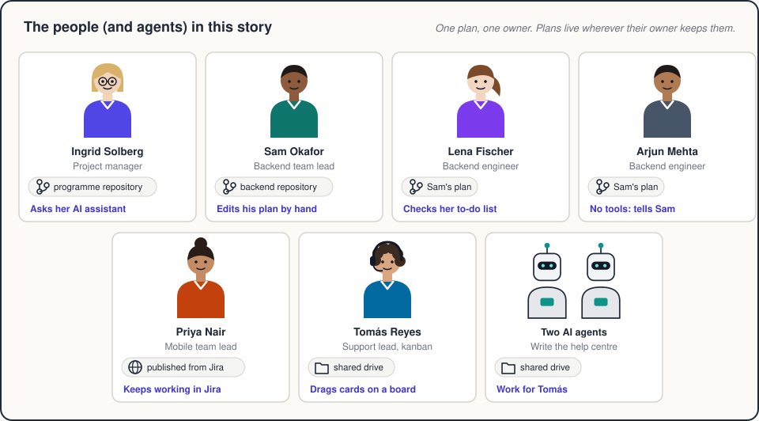

Pantry, an online grocer, will let customers book a delivery slot. The launch is on 15 September.
Four teams are involved, and each works differently:

- **Ingrid**, the project manager, owns the launch. An AI assistant keeps her plan up to date for her,
  and she follows progress on a Gantt chart.
- **Sam** leads the backend team and edits his plan by hand. **Lena** and **Arjun** work in his team.
  Arjun uses no tools at all: he tells Sam.
- **Priya** leads the mobile team. Her team lives in Jira, and a small script publishes her plan from it.
- **Tomás** leads support and works on a kanban board he had built on top of his plan.
- **Two AI agents** write the help-centre articles for Tomás.

## 1. Ingrid starts the plan

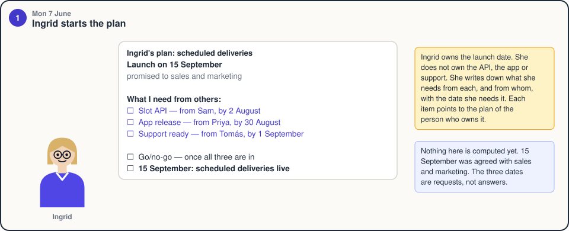

Ingrid owns one thing: the launch date, which she agreed with sales and marketing. She does not own
the backend, the app or support, so she doesn't plan them. She writes down what she needs from each
owner, and by when.

Those dates are requests, not answers. They become commitments only when the owner agrees.
[Behind the story →](STORY-DETAILS.md#1-ingrid-starts-the-plan)

## 2. Asking for commitments

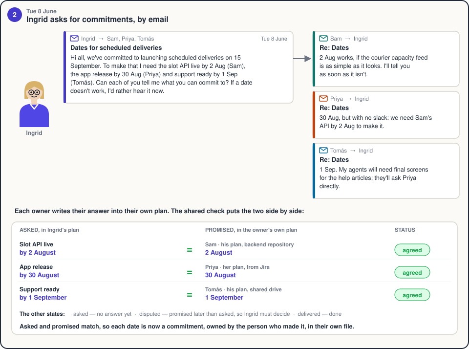

Ingrid asks by email, as she always would. Each owner answers, and also writes the date they promise
into their own plan: Sam in his, Priya in Jira, Tomás on his board. Nobody touches anyone else's plan.

Now every request has two sides, kept by two different people: what Ingrid asked, and what the owner
promised. The checking tool puts them side by side. When they match, the request is **agreed**, and
from then on the date belongs to the person who promised it. If an owner had promised a later date, the
request would show as **disputed**, and the next move would be Ingrid's.
[Behind the story →](STORY-DETAILS.md#2-asking-for-commitments)

## 3. Lena picks up her work

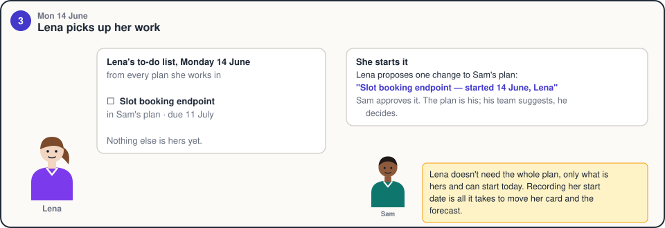

Lena doesn't need the whole project. She asks for her own to-do list, drawn from every plan she works
in, and starts the one task waiting for her. Sam's plan belongs to Sam: his team suggests changes, he
approves them. [Behind the story →](STORY-DETAILS.md#3-lena-takes-work-from-her-queue)

## 4. Tomás runs support as a kanban board

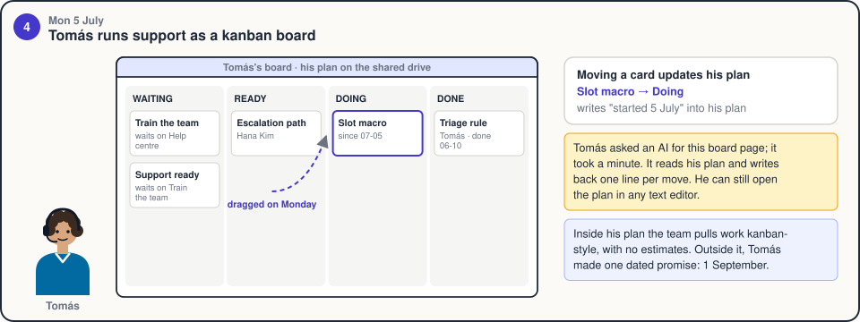

Tomás wanted a board, so he asked an AI to build him one. It took a minute. Dragging a card to "Doing"
writes "started today" into his plan; dragging it to "Done" ticks it off. Inside his team, work flows
kanban-style, without estimates. To the rest of the project he made exactly one promise: support is
ready on 1 September. That is the only date anyone else plans on.
[Behind the story →](STORY-DETAILS.md#4-tomás-runs-a-kanban-on-a-one-page-board-over-his-file)

## 5. The agents work, and ask a person for a date

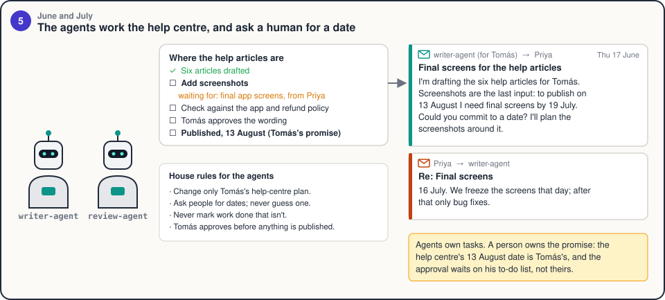

The help-centre articles are written by two AI agents. They follow simple house rules: change only
Tomás's help-centre plan, never guess a date, never mark work done that isn't. When the writer agent
needs final app screens, it asks Priya by email, like anyone else would.

Agents can own tasks. A person owns the promise: the help centre's 13 August date is Tomás's, and the
final approval is on his list, not theirs.
[Behind the story →](STORY-DETAILS.md#5-the-agents-work-and-ask-a-human-for-a-date)

## 6. Sam finds a problem, and says so early

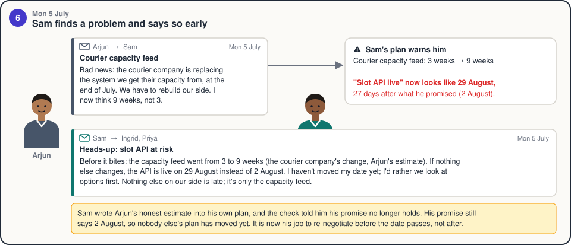

Arjun learns that the courier company is changing its system. His estimate goes from three weeks to
nine. Sam writes the honest estimate into his plan, and the check warns him at once: his promise of
2 August no longer holds.

Nothing has moved in anyone else's plan yet, because Sam's promise still says 2 August. That is on
purpose: **a promise is not a forecast**, and only Sam can change his. Keeping a promise includes
moving it **before** the date passes, so Sam emails Ingrid and Priya the same morning.
[Behind the story →](STORY-DETAILS.md#6-sam-finds-a-problem-and-says-so-early)

## 7. Ingrid checks the impact on the Gantt chart

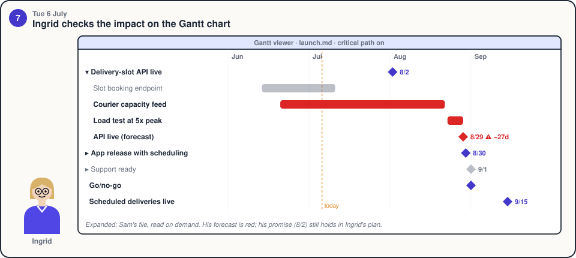

Ingrid opens the Gantt chart and looks inside Sam's part. The backend work is on the critical path:
backend, then the app, then the go/no-go, then the launch. A month late on the backend means a month
late on the launch. Before she talks options, she wants to know whether all of it is really needed
first. [Behind the story →](STORY-DETAILS.md#7-ingrid-checks-the-impact-on-the-gantt-chart)

## 8. Three owners negotiate, and split the promise

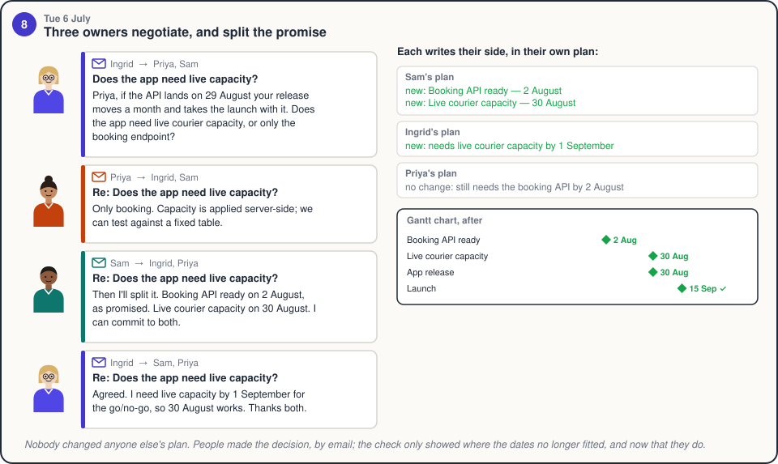

The solution comes from people, by email. Priya's app only needs the booking part on 2 August; live
courier capacity can come later. So Sam splits his promise in two: booking on 2 August, as before,
and live capacity on 30 August. Ingrid says she needs capacity by 1 September for the go/no-go. Each
writes their own side into their own plan. Priya changes nothing. The launch keeps two weeks to spare.
[Behind the story →](STORY-DETAILS.md#8-three-owners-negotiate-and-split-the-promise)

## 9. Ingrid lets her assistant keep the plan

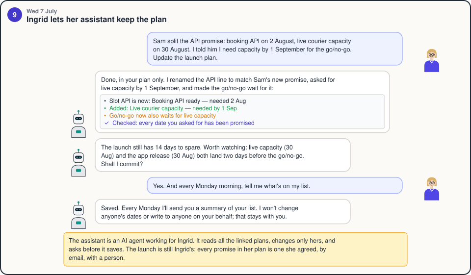

Ingrid doesn't edit her plan herself. She tells her AI assistant what she agreed, and it updates her
plan, checks that everything still fits, and asks before saving. Every Monday it sends her a summary
of her list. It cannot make promises for her or change anyone else's dates. Handing over the typing
does not hand over the ownership: the launch is still Ingrid's.
[Behind the story →](STORY-DETAILS.md#9-ingrid-lets-her-assistant-keep-the-plan)

## Ownership, in five lines

1. **Every plan has one owner**, and only that owner changes it. Others ask; the owner writes.
2. **A request is not a commitment.** A date becomes a commitment when the owner promises it.
3. **A promise is not a forecast.** Others plan on your promise, not on your internal estimates.
4. **Keeping a promise includes moving it early.** When you see you will miss it, say so before
   the date passes.
5. **Agents can do the work and keep plans for people; people own the promises.**

## Bring your own tools

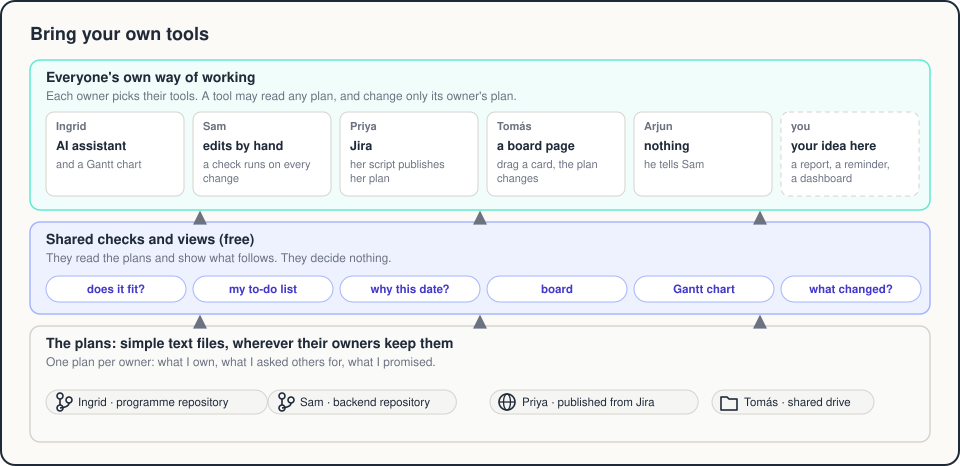

Nobody in this story changed how they work. Ingrid talks to an assistant, Sam edits by hand, Priya
stays in Jira, Tomás drags cards, Arjun uses nothing. What they share is the habit of writing down what
they own, asked for and promised. Because the plans are simple text, anyone can add a tool on top: a
report, a reminder, a dashboard, a bridge to the tracker your team already uses. The one rule for
those tools is the same as for people: **read any plan, change only your own.**
[Behind the story →](STORY-DETAILS.md#10-layer-your-own-tooling-on-top)

Next: see [behind the story](STORY-DETAILS.md), build a first plan in the [tutorial](TUTORIAL.md), or
read how to [adopt projectmd](ADOPTING.md) in a team.
